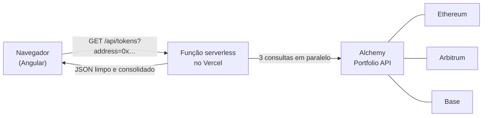

# DeFinance

**Veja quanto vale uma carteira cripto em segundos, sem conectar nada.**

DeFinance é um painel de portfólio somente leitura para carteiras EVM. Você cola o endereço público de uma carteira e o app mostra os tokens, o valor total em dólar e a distribuição por ativo em **Ethereum, Arbitrum e Base**, tudo em uma tela.

### 👉 [Abrir a demo ao vivo](https://de-finance-psi.vercel.app)

Para testar, use a carteira pública de Vitalik Buterin, cofundador do Ethereum:

```
0xd8dA6BF26964aF9D7eEd9e03E53415D37aA96045
```


<p align="center">
  
  
</p>

---

## Funcionalidades

- **Visão consolidada de três redes:** Ethereum, Arbitrum e Base consultadas em paralelo e somadas em um único resultado.
- **Valor total em destaque**, em USD.
- **Gráfico de distribuição:** o mesmo ativo em redes diferentes vira uma fatia só, e os ativos menores são agrupados em "Outros" para o gráfico continuar legível.
- **Lista de tokens** com quantidade, preço unitário e valor, ordenada do maior para o menor.
- **Filtro por rede**, com a contagem de tokens em cada uma.
- **Filtro automático de spam:** tokens sem preço de mercado, sem dados ou com valor abaixo de US$ 0,01 não aparecem.
- **Tema claro e escuro:** segue o sistema na primeira visita e lembra a escolha depois.
- **Estados bem resolvidos:** esqueleto animado enquanto carrega, mensagem clara para carteira vazia e botão "Tentar novamente" quando algo falha.
- **Responsivo:** funciona no celular sem rolagem horizontal.

## Segurança e privacidade

- **Somente leitura.** O app só recebe o endereço público. Nunca pede chave privada, frase de recuperação ou conexão de carteira, e não existe nenhuma forma de movimentar fundos por ele.
- **A chave da API fica no servidor.** O navegador fala apenas com o servidor do próprio DeFinance, e é ele quem consulta o provedor de dados. A chave nunca chega ao navegador e é removida de qualquer mensagem de erro (há testes automatizados garantindo isso).
- **Nenhum dado guardado.** Não há login nem banco de dados. A única coisa salva é a preferência de tema, no próprio navegador.
- **Validação dupla.** O endereço é validado no navegador, antes de qualquer chamada, e de novo no servidor.

## Como funciona



1. O navegador valida o endereço e chama uma única rota, `/api/tokens`.
2. A função serverless consulta a Alchemy nas três redes ao mesmo tempo, percorre a paginação e remove duplicados.
3. A mesma função filtra spam e poeira, converte saldos e preços e soma o total.
4. O navegador recebe uma resposta pronta para exibir. Não há cálculo pesado no front.

### Decisões que fazem diferença

- **Nunca mostra um total errado.** Se qualquer uma das redes falhar, a resposta é um erro com opção de tentar de novo, e não um total parcial que pareceria verdadeiro.
- **Rápido em consultas repetidas.** As respostas ficam 60 segundos em cache na CDN do Vercel, o que também economiza a cota da API.
- **Página inicial leve.** A biblioteca do gráfico só é baixada quando há dados para mostrar.
- **Sem respostas atrasadas na tela.** Uma nova consulta cancela a anterior, e cada consulta tem limite de 15 segundos.
- **Validado contra a API real.** A integração foi conferida com respostas reais da Alchemy antes de ir para produção. Um exemplo do que isso pegou: a API devolve o ETH nativo sem nome, símbolo nem casas decimais, o que faria o principal ativo da carteira sumir da lista. O caso é tratado e coberto por teste.

## Tecnologias

| Camada     | Tecnologia                                                           |
| ---------- | -------------------------------------------------------------------- |
| Front-end  | Angular 22 (componentes standalone, zoneless, Signals), TypeScript 6 |
| Gráfico    | ApexCharts 8 via `ng-apexcharts`, carregado sob demanda com `@defer` |
| Back-end   | Vercel Functions em Node.js 24                                       |
| Dados      | Alchemy Portfolio API (saldos, metadados e preços)                   |
| Testes     | Vitest 5 (jsdom para o front, Node para o servidor)                  |
| Hospedagem | Vercel, com deploy automático a cada push                            |

## Qualidade

**102 testes automatizados**, todos passando:

- **69 no front-end:** componentes, serviço de carteira, formatação de valores, tema e filtros.
- **33 no servidor:** validação de endereço, conversão dos dados da Alchemy, filtros de spam, paginação, falhas parciais e proteção da chave da API.

## Rodando localmente

**Pré-requisitos:** Node.js 24, uma conta no [Vercel](https://vercel.com) e uma chave da [Alchemy](https://dashboard.alchemy.com) com Ethereum, Arbitrum e Base habilitadas.

```bash
npm install
npx vercel link
```

Cadastre a variável `ALCHEMY_API_KEY` no projeto do Vercel, em Settings → Environment Variables, nos ambientes Production, Preview e Development. Depois:

```bash
npx vercel env pull .env.local
npx vercel dev
```

O app abre em http://localhost:3000. O `vercel dev` usa as variáveis do projeto no Vercel, por isso a chave precisa estar cadastrada lá.

**Só quer ver a interface?** `npm run start:mock` sobe o app em http://localhost:4200 com dados fictícios, sem precisar de chave nem de conta no Vercel.

### Testes

```bash
npx ng test --watch=false     # front-end
npm run test:node             # servidor
npm run typecheck:server      # tipos do servidor
```

### Estrutura

```
api/          Função serverless do Vercel (entrada fina, sem lógica)
server/       Cliente da Alchemy, conversão dos dados e regras da rota /api/tokens
shared/       Código usado pelo front e pelo servidor (contrato de dados, validação)
src/app/      Aplicação Angular
  core/       Serviço da carteira, formatação e tema
  features/   Componentes de tela (entrada, resumo, gráfico, lista, filtro)
  mock/       API fictícia para desenvolvimento
docs/         Documento de design e backlog
```

## Limitações conhecidas

- Aceita apenas endereços `0x`. Nomes ENS (como `vitalik.eth`) ainda não são resolvidos.
- Apenas Ethereum, Arbitrum e Base.
- Valores apenas em USD.
- O spam é filtrado por heurística. Um token de spam que tenha preço de mercado pode aparecer.
- Carteiras muito grandes são lidas até 5 páginas por rede (cerca de 500 tokens).

## Próximos passos

Planejados para versões futuras (detalhes em [`docs/backlog.md`](docs/backlog.md)):

- Posições em protocolos DeFi (staking, liquidez, empréstimos)
- Várias carteiras ao mesmo tempo
- Histórico da evolução do patrimônio
- Alertas e notificações
- Valores em EUR

---

Desenvolvido por **Gabriel Feliciano** · [GitHub](https://github.com/Gabriielfeliciano)
